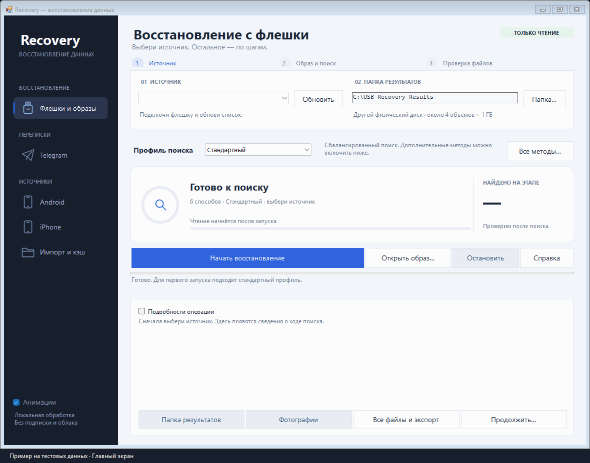

# Recovery

Восстановление файлов и поиск в сохранившихся локальных данных Telegram для Windows x64

**[Скачать последний выпуск](https://github.com/fl1nky/usb-recovery/releases/latest)**

Установка и отдельный Python не нужны

1. Скачай ZIP, распакуй целиком и открой `USB-Recovery.exe`
2. **Флешка:** открой «Флешки и образы», выбери носитель и папку на другом физическом диске → «Начать восстановление»
3. **Telegram:** нажми «Анализировать»; для своей копии или дампа выбери «Источник…», затем ищи по ключевым словам
4. **APFS / RAID / BitLocker:** выбери соответствующий раздел, открой RAW-образ; укажи свой ключ или известные параметры массива → «Анализировать» / «Собрать и найти»
5. **Экспорт:** открой найденные файлы, проверь содержимое и сохрани нужные в отдельную папку

Обработка локальная, без загрузки в облако. Не записывай результаты на исходный носитель: перезаписанные байты восстановить нельзя

[Все способы поиска](docs/guides/recovery.md) · [APFS, RAID и BitLocker](docs/guides/storage.md) · [Сравнение с аналогами](docs/guides/comparison.md)

Посмотреть интерфейс

Для разработки: [сборка и проверки](docs/development/build.md) · [устройство проекта](docs/development/architecture.md)
