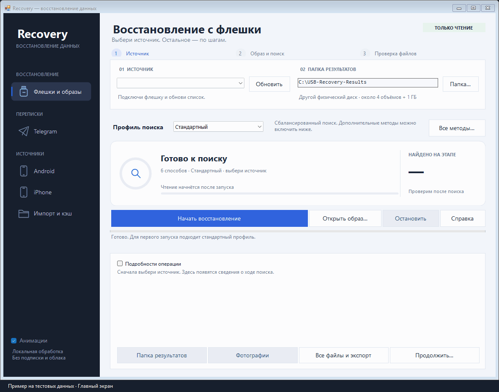

# USB Recovery

**[English](README.md)** · [Русский](README.ru.md)

[](https://github.com/fl1nky/usb-recovery/actions/workflows/ci.yml)
[](LICENSE)
[](#)
[](#)
[](#)

**USB-Recovery** is a high-performance, open-source data recovery and digital forensics suite for raw disk images, USB flash drives, hard disks, and memory dumps. It combines intelligent fragmented media carving, deep filesystem metadata salvage (APFS, ReFS, ext4, NTFS, FAT), RAID reconstruction, and specialized application artifact extraction.

**[Download Latest Windows x64 Release](https://github.com/fl1nky/usb-recovery/releases/latest)**

*Extract the portable ZIP and run `USB-Recovery.exe`. No installation, drivers, or Python dependencies required.*

---

## Why USB-Recovery?

Most data recovery tools fall into two extremes:
1. **Expensive Commercial Tools ($80 – $899+)** like R-Studio, UFS Explorer, DMDE, and Disk Drill. Their free demo editions impose crippling artificial limits (e.g., maximum 256 KB file size, 500 MB lifetime cap, or 4,000 files per folder).
2. **Aging Open-Source Tools** like PhotoRec and TestDisk. PhotoRec performs purely linear carving: it discards all folder structures and filenames (`f12345.jpg`), and corrupts or truncates files broken into non-contiguous fragments.

**USB-Recovery bridges this gap:** professional enterprise-grade recovery algorithms, modern filesystem salvage, and smart fragmented file reconstruction &mdash; **100% free, unlimited, and open-source under GNU AGPLv3**.

---

## Comparison Matrix

| Feature / Capability | USB-Recovery (Free) | PhotoRec / TestDisk (GPLv2) | DMDE Free Edition | R-Studio ($80–$899) | Disk Drill ($89) |
| :--- | :---: | :---: | :---: | :---: | :---: |
| **Pricing Model** | **Free (AGPLv3)** | Free (GPLv2) | Proprietary / Nagware | Commercial ($80+) | Commercial ($89) |
| **Recovery File Size Limit** | **Unlimited** | Unlimited | Max 4,000 files/dir | Max 256 KB | Max 500 MB |
| **Fragmented Carving (2-Gap / 3-Frags)** | **Yes (Smart Stitch)** | No (corrupts/chops) | Limited | Limited | Partial |
| **Directory Tree & Filename Salvage** | **Yes (Virtual Tree)** | No (renames all files) | Partial | Yes | Yes |
| **APFS Unreferenced Inode / Extents** | **Yes** | No | Forensic tier only | Technician tier only | Partial |
| **ReFS 3.14 B+ Tree Salvage** | **Yes** | No | No | Technician tier only | No |
| **ext4 JBD2 Journal Salvage** | **Yes** | Partial | Partial | Yes | Partial |
| **RAID 0 / 1 / 5 Auto-Assembly** | **Yes (Linux MD / DDF)** | Basic | Manual | Paid editions | Partial |
| **Telegram Desktop Local Cache Carver** | **Yes (19 Formats)** | No | No | No | No |
| **Session Continuity / Checkpoints** | **Yes (Multi-Stage)** | Resume file | Scan state | Scan state | Basic |
| **Operating Modes** | **GUI + Headless CLI** | CLI / QPhotoRec | GUI + Console | GUI | GUI |
| **Telemetry & Network Calls** | **0% (100% Offline)** | 100% Offline | Online license check | Online activation | Cloud telemetry |

---

## Key Features

### 1. Smart Fragmented Media Reconstruction
When files are deleted from FAT, exFAT, or corrupted filesystems, cluster fragmentation causes standard signature carvers to output corrupted images or truncated videos. USB-Recovery includes:
- **JPEG Two-Gap Reassembly**: Validates Huffman restart markers and MCU block boundaries to repair split photos.
- **MP4 / MOV Fragment Stitching**: Rebuilds fragmented `moov` / `mdat` atom streams and syncs audio/video tracks.
- **PNG IDAT Defragmentation**: Scans across unallocated clusters to reconstruct split PNG streams with zlib CRC verification.
- **ZIP / Office XML Rebuilding**: Restores docx, xlsx, and zip archives even when the central directory is detached.

### 2. Next-Generation Filesystem Support
- **Apple APFS**: Recovers intact filesystem hierarchies, APFS container superblocks (NXSB/APSB), object maps (OMAP), and salvages unreferenced inodes and extents from wiped volumes.
- **Windows ReFS 3.14**: Parses ReFS metadata tables and B+ tree leaves to extract files inaccessible by standard Windows drivers.
- **Linux ext4**: Recovers deleted inodes, traverses extent trees, and recovers uncommitted metadata from the ext4 JBD2 journal.
- **Linux Btrfs**: Discovers primary and mirror superblocks (`_BHRfS_M`), system chunk array mappings, and parses tree leaves to reconstruct directories, file records, and inline/regular extents.
- **Linux XFS**: Discovers Allocation Group (AG) superblocks (`XFSB`), parses core inode structures (`IN`), extracts 128-bit packed BMBT extent descriptors, and recovers shortform and block directories.
- **OpenZFS / ZFS**: Traverses VDEV labels (0, 1, 2, 3), scans 128-slot uberblock arrays (`0x00bab10c`) to resolve the latest active Transaction Group (TXG), and carves root block pointers and dnode object sets.

### 3. Professional Camera RAW Photo Recovery
- **Canon CR2 & CR3**: Extracts full camera parameters and extracts embedded full-resolution JPEG previews even if the raw bayer payload is partially corrupted.
- **Nikon NEF, Sony ARW, Adobe DNG, Fujifilm RAF**: Native TIFF IFD and Fuji RAF container traversal, recovering EXIF metadata (Make, Model, Lens, ISO, F-stop, Shutter, Timestamp) and preview JPEGs.
- **Dedicated Forensic CLI**: `USB-Recovery.exe salvage-raw <path> -o <dir> --extract-previews` for high-throughput batch photo salvage.
- **NTFS & FAT**: Deep Master File Table (MFT) record carving, $LogFile replay, and VFAT long filename stitching.

### 3. Application Artifacts & Messenger Recovery
- **Telegram Desktop**: Deeply inspects local SQLite and LevelDB storage to recover 19 message record types, associating cached photos, audio messages, and documents with original senders and timestamps.

### 4. Enterprise Storage & Encryption
- **Software RAID**: Auto-detects Linux MD (Software RAID) and SNIA DDF v1.2 metadata, rebuilding RAID 0 (striping), RAID 1 (mirroring), and RAID 5 (distributed parity).
- **BitLocker**: Decrypts BitLocker volumes when given a recovery key password or 48-digit numerical recovery key.
- **Forensic Containers (E01 / Ex01)**: Native random-access stream reader for EnCase, FTK Imager, and Guymager compressed disk images, including multi-segment spans (`.E01`..`.E99`, `.EAA`..`.EZZ`) and zlib chunk decompression with zero external dependencies.
- **GNU ddrescue Mapfiles**: Imports rescue mapfiles (`.map`) to focus recovery on healthy sectors and immediately skip known hardware errors.

### 5. Resilient Session Continuity
Multi-terabyte drives can take hours or days to analyze. USB-Recovery maintains persistent session checkpoints: if interrupted or stopped, scanning resumes immediately from the last verified block without re-reading the entire media.

---

## Quick Start

### Graphical User Interface (GUI)
1. Launch `USB-Recovery.exe`.
2. Choose a physical drive, raw disk image (`.dd`, `.raw`, `.img`), or storage container.
3. Select recovery profile (e.g. *Full Scan*, *Fast Metadata*, *Photos & Video*, or *Telegram*).
4. Browse the interactive virtual file tree, preview recovered documents or media, and export files.

<details>
<summary>Preview Interface Screenshot / Demo</summary>



</details>

### Headless Command-Line Interface (CLI)
Designed for forensic workflows, automation scripts, and headless servers:

```powershell
# Show command-line help and usage
.\USB-Recovery.exe --help

# Print version and build metadata
.\USB-Recovery.exe --version

# Probe an image file to identify partitions and filesystem structures
.\USB-Recovery.exe probe C:\images\evidence.raw

# Run an automated recovery scan to an output directory
.\USB-Recovery.exe scan C:\images\evidence.raw -o C:\recovered --mode full

# Fast metadata-only scan for APFS or NTFS
.\USB-Recovery.exe scan C:\images\evidence.raw -o C:\recovered --fs apfs

# Launch interactive local Web-UI with Cluster Map & Hex Inspector
.\USB-Recovery.exe serve C:\images\evidence.raw --port 8080 --open-browser

# Salvage damaged Office documents (DOCX, XLSX, PPTX, ODT) and extract plain text
.\USB-Recovery.exe salvage-office C:\images\corrupted_evidence.raw -o C:\salvaged_office

# Carve & inspect professional Camera RAW photos (CR2/CR3, NEF, ARW, DNG, RAF) and extract previews
.\USB-Recovery.exe salvage-raw C:\images\camera_card.raw -o C:\salvaged_photos --extract-previews

# Forensic Btrfs metadata scout, chunk mapping & file extent recovery
.\USB-Recovery.exe btrfs-scout C:\images\linux_btrfs.img

# Forensic XFS metadata scout, AG superblocks & BMBT extent recovery
.\USB-Recovery.exe xfs-scout C:\images\linux_xfs.img

# Forensic ZFS pool scout, uberblocks & dnode object traversal
.\USB-Recovery.exe zfs-scout C:\images\zfs_pool.raw

# Run targeted recovery scan using GNU ddrescue mapfile
.\USB-Recovery.exe scan C:\images\evidence.raw -o C:\recovered --ddrescue-map C:\images\evidence.map
```

---

## Building from Source

### Prerequisites
- Windows 10/11 x64 or Windows Server 2016+
- .NET Framework 4.8 developer targeting pack (uses Windows default `csc.exe`)
- PowerShell 5.1+

### Build Application
```powershell
.\scripts\build-app.ps1
```
The compiled standalone executable is output to `.build\app\USB-Recovery.exe`.

### Run Offline Quality Verification
All tests run with firewall policies blocking outbound network traffic to guarantee zero telemetry:
```powershell
$env:__COMPAT_LAYER = 'RunAsInvoker'
.\tests\QualityOfflineTests.ps1 -ApplicationDirectory .build\app
```

---

## Architecture & Design

USB-Recovery is built on a high-throughput, memory-safe architecture:
- **Non-Destructive Guarantee**: Sources are mounted strictly read-only.
- **Streaming Pipeline**: Cluster processing leverages SIMD-aligned buffer pools to maximize NVMe and SATA SSD throughput.
- **Zero External Runtimes**: Self-contained C# executable without heavy Java or Python runtimes.

For more technical details, read:
- [Architecture & Subsystems](docs/development/architecture.md)
- [Storage & RAID Matrix](docs/guides/storage.md)
- [Recovery Techniques Guide](docs/guides/recovery.md)
- [Competitive Benchmarks & Protocols](docs/guides/comparison.md)

---

## Contributing

Contributions are warmly welcomed! Please read our [Contributing Guidelines](CONTRIBUTING.md) and submit pull requests to the `main` branch.

---

## License

This project is licensed under the **GNU Affero General Public License v3.0** ([AGPL-3.0](LICENSE)).
Free to use, inspect, modify, and distribute with copyleft protection.
