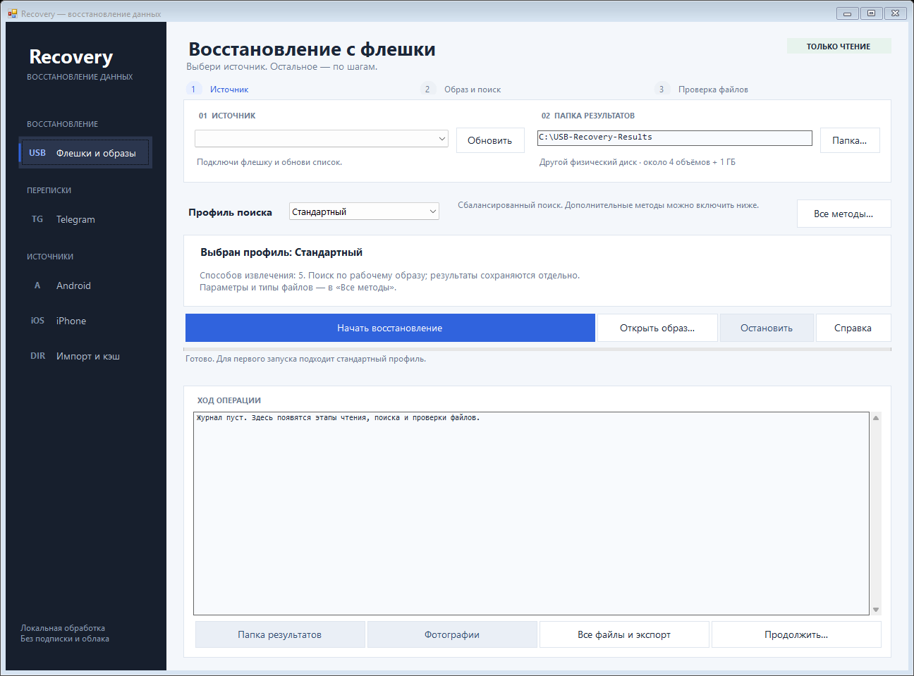
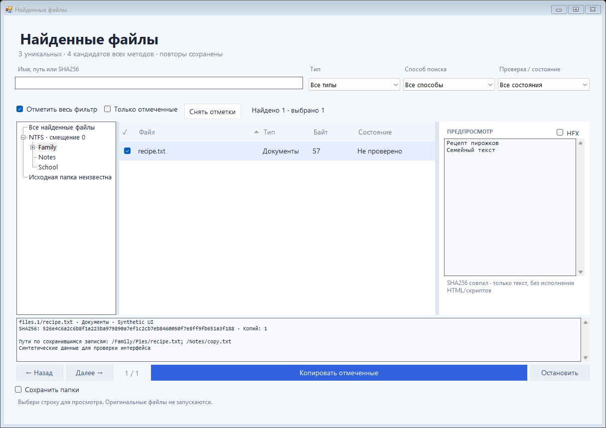

# Recovery

Программа для Windows, которая ищет удалённые файлы на флешках и сохранившиеся локальные данные Telegram

Всё обрабатывается на компьютере: образы накопителей, фотографии, копии баз и экспорты переписок. Найденные данные сохраняются в отдельный архив с поиском, предпросмотром и указанием источника

**[Скачать готовую сборку](https://github.com/fl1nky/usb-recovery/releases/latest)** · [Сравнение с аналогами](COMPETITOR-COMPARISON.md) · [Инструкция](RECOVERY-OCT30.md) · [Сборка из исходников](docs/BUILD.md)

## Как запустить

1. Открой последний выпуск в разделе **Releases** и скачай архив переносимой программы
2. Распакуй архив целиком на компьютер или другой исправный диск
3. Запусти `USB-Recovery.exe` из распакованной папки

Для готовой сборки не нужно устанавливать Python или Rust, подключение к интернету не требуется. Нужна Windows x64 с .NET Framework 4.8. Для чтения физического накопителя Windows может запросить права администратора

Один EXE отдельно от остальных файлов не является полной программой. Кнопка **Code → Download ZIP** скачивает исходники, а готовая программа находится в **Releases**

## Восстановить файлы с флешки

1. Открой **«Флешки и образы»**, подключи флешку и нажми **«Обновить»**
2. Выбери папку результатов на **другом физическом диске**
3. Начни со стандартного профиля и нажми **«Начать восстановление»**
4. Программа создаст образ и выполнит выбранные способы поиска по копии
5. Открой **«Все файлы и экспорт»**, проверь находки и скопируй нужные

Если образ уже есть, используй **«Открыть образ…»**. Его можно анализировать с другими настройками без повторного чтения флешки

После удаления нужного файла прекрати запись на флешку. Программу, образ и результаты сохраняй на другом диске. Перезаписанные байты восстановить этим способом нельзя

## Найти локальные переписки Telegram

Нажми **«Анализировать»** в разделе Telegram: программа проверит известные доступные папки Telegram и экспортов на компьютере

Для существующей копии телефона выбери **«Источник…» → «Папка / копия телефона…»**. Для предоставленного дампа выбери **«Дамп памяти / файл…»**. Затем нажми **«Анализировать»** и ищи по словам или регулярному выражению, например `рецепт|пирожк.*`

| Источник | Что можно получить |
|---|---|
| Экспорт Telegram JSON/HTML | Текст, доступные поля сообщений и сохранившиеся вложения |
| Поддерживаемая читаемая база Telegram Android | Текстовые TL-записи, подписи к фотографиям и полные встроенные кэшированные миниатюры |
| База с сохранившимся SQLite WAL | Предыдущие зафиксированные версии, если все необходимые страницы есть в проверенном журнале |
| Дамп или остатки базы | Читаемые текстовые фрагменты с исходным путём, SHA256 и позицией в файле |
| Защищённый `tdata` Telegram Desktop | Замечание о найденном защищённом источнике; расшифровка истории не выполняется |

Сообщения, предыдущие версии, уведомления и неподтверждённые фрагменты показываются раздельно. У неизвестного автора или даты программа не придумывает значение. Миниатюра не выдаётся за оригинал фотографии

Это поиск того, что сохранилось в доступных файлах. Программа не возвращает удалённую облачную историю, не извлекает закрытую память телефона по обычному USB и не создаёт дамп работающего устройства. Root, jailbreak, обход блокировки и извлечение ключей сеанса не входят в проект

## Основные возможности

- Поиск по сохранившимся метаданным FAT/exFAT/NTFS и по содержимому файлов
- Потерянные разделы, резервные загрузочные записи, отдельные записи NTFS и потерянные каталоги FAT
- JPEG/PNG внутри других данных, поддерживаемые контейнеры и отдельные случаи фрагментированных файлов
- Спасение целых элементов повреждённого ZIP и сборка раздельных ZIP/Office-записей с проверкой CRC
- Свои типы файлов: заголовок из образца, смещение и известный конец либо фиксированный размер
- Продолжение съёма образа по журналу блоков и повторное использование завершённых этапов поиска
- Фильтры, дерево найденных папок, изображения, текстовый и HEX-предпросмотр
- Экспорт выбранного с проверкой SHA256 и сохранением подтверждённых исходных папок
- Импорт доступных файлов Android/iPhone и поддерживаемых существующих локальных копий

## Сравнение с другими программами

| Программа | Для чего полезна | Что отличает этот проект |
|---|---|---|
| **DMDE** | Реконструкция файловой системы, Raw-поиск, редактор диска, дополнительные функции в платных редакциях | Простой общий интерфейс, локальный архив Telegram, явное разделение сообщений и фрагментов |
| **R‑Studio** | Широкий охват файловых систем, виртуальных дисков и сложных сценариев; набор зависит от редакции | Более узкий набор задач: флешки, обычные образы и предоставленные локальные данные Telegram |
| **UFS Explorer** | Разные файловые системы и образы; для RAID есть отдельные продукты | Не требует покупки лицензии проекта, но имеет собственные технические ограничения |
| **PhotoRec / TestDisk** | Бесплатные инструменты для поиска по сигнатурам и работы с файловыми системами | Используются внутри Recovery вместе с дополнительными методами, каталогом, проверками и интерфейсом |

Recovery **не доказала превосходство над всеми платными аналогами**. Практическое парное сравнение проводилось только с DMDE Free Console на двух собственных тестовых образах: один фрагментированный JPEG NTFS восстановили обе программы; два целых изображения на произвольных смещениях нашёл наш дополнительный проход, а использованный проход DMDE с исходными настройками результатов не показал. Другие настройки DMDE исчерпывающе не перебирались

Это три эталонных файла, а не общий процент восстановления. R‑Studio и UFS Explorer сравнивались по официальной документации, без практического прогона. Полная таблица, протокол и ссылки на производителей — в [сравнении](COMPETITOR-COMPARISON.md)

## Ограничения и проверки

APFS, ReFS, ext4, RAID, BitLocker, аппаратное восстановление NAND и универсальная сборка разрозненного видео не реализованы. Своя сигнатура определяет кандидата по заданной границе, но не доказывает целостность формата. Предыдущая версия записи не устанавливает причину её изменения или факт удаления

Проверки выполнены на искусственных файлах, DB/WAL, потоках и образах. Для готового комплекта проверены работа без Python в PATH, запрет сети для тестируемых процессов, контрольные суммы компонентов, отмена и продолжение. Настоящие USB, Android и iPhone пользователя в этом этапе не испытывались

В архиве выпуска находятся `package-sha256.json` и отчёты в папке `tests`. Отчёт `RecoveryOctober30-validation.json` связывает результаты с конкретными исполняемыми файлами, исходниками тестов и журналами. Старые отчёты относятся к своим сборкам

Если ничего не найдено, это означает отсутствие подходящих данных в доступных источниках, а не доказательство окончательного уничтожения переписки

## Для разработчика

Основной интерфейс и поиск по образам написаны на C# / .NET Framework. Переносимый обработчик Telegram, изображений и iPhone-копий — на Python 3.12 и поставляется готовым EXE

В Git хранятся код, инструкции и тестовые исходники. Готовые исполняемые компоненты, колёса Python, большие образы и локальные результаты не нужно добавлять в историю Git. Переносимая сборка с лицензиями и зависимостями пересборки распространяется через **Releases**

Команды сборки и порядок восстановления локальных зависимостей: [docs/BUILD.md](docs/BUILD.md). Лицензии сторонних компонентов: [THIRD-PARTY.md](THIRD-PARTY.md)
